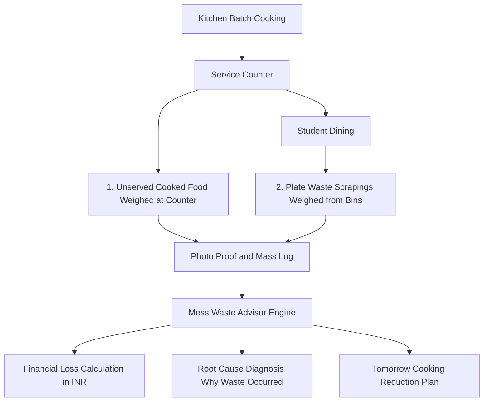

# Mess Waste Advisor
Latent 48: Bring the Physical World to AI (Granica and IIT Guwahati Hackathon)
Tanish Agarwal, Rishi Agarwal, Madhav Goel (IIT Guwahati, 2026)

# 1. Problem Definition and User Framing

## The Physical Problem
Hostel messes cook hundreds of kilograms of food thrice daily for thousands of resident students. Quantities are routinely set by habit and fixed catering routines rather than empirical consumption records. Waste leaves no structured trace: unserved kitchen leftovers and plate scrapings are discarded together into municipal bins without being weighed. As a result:
* The mess cannot distinguish whether waste is caused by over preparation (cooking too much) or recipe and portion dissatisfaction (students rejecting a dish).
* High waste recipes and oversized portions repeat week after week with zero feedback loops.

## The Named Users and Decision Makers
1. Primary Operational User: The Hostel Mess Manager, who decides daily cooking batch quantities in kg or liters and ladling portion sizes for each meal.
2. Institutional Decision Makers: The Hostel Mess Committee and HAB (Hostel Affairs Board), who approve monthly catering menus, monitor contractor waste compliance, and penalize recurring food waste.

## The Core Question
For each meal, what is wasted, how much, why, and what should the mess change: the menu, the ladling portion, or the quantity cooked?

# 2. The Physical Workflow and Measurement Points



## The Two Measurement Streams
1. Unserved Cooked Food (Kitchen Leftovers): Food prepared but never taken or served to students. Weighed directly in kitchen vessels at the close of service. Primary lever: Batch Cooking Volume.
2. Plate Waste (Scrapings): Food served onto student plates but discarded into post meal waste dustbins. Weighed directly from the bins. Primary lever: Portion Sizing and Recipe Acceptance.

# 3. Dataset Architecture and Data Honesty Audit

The dataset records physical post meal audits conducted across IIT Guwahati hostel mess halls between 25 September 2026 21:10 and 26 September 2026 21:41 (approximately 24.5 hour collection window).

## Schema and Data Dictionary

| Column Name | Data Type | Nulls | Description |
| :--- | :--- | :---: | :--- |
| Date | Date YYYY MM DD | 0 / 55 | Date the meal observation occurred |
| Time | Time HH MM SS | 0 / 55 | Intake and upload timestamp |
| Hostel | Categorical | 0 / 55 | Hostel mess hall name (Barak, Brahma, Dihing, Disang, Kameng, Kapili, Lohit, Siang, Umiam) |
| Meal type | Categorical | 0 / 55 | One of Breakfast, Lunch, Dinner |
| Unserved Food Wastage | Numeric in kg | 8 / 55 | Mass of unserved food left in kitchen pots at counter close |
| Plate Food wastage total | Numeric in kg | 22 / 55 | Mass of food scraped from eaten plates into dustbins |
| Photo Proof | URL | 0 / 55 | Google Drive URL providing photographic evidence of the waste bin or scale |

## Row Count and Observation Deduplication
* Raw Rows: 55 entries (resulting from multi angle photo captures of the same audit event).
* Unique Observation Events: 24 events (deduplicated by Date, Time, Hostel, Meal type).
* Visual Provenance: 100% of recorded events are linked to timestamped photo proofs.

## Data Honesty and Provenance Breakdown

| Category | Extent | Method and Integrity Treatment |
| :--- | :---: | :--- |
| Observed (Direct) | Approximately 92% Unserved, 50% Plate | Direct digital scale readings with exact decimal precision (such as 38.255 kg, 63.46 kg, 9.94 kg). |
| Inferred (Proxy) | 1 confirmed event | Derived via calibrated volumetric proxy (2.5 ft vessel approximately 46 kg; rice density approximately 1.4 g per mL) for Kameng Lunch when floor scales were inaccessible. |
| Synthetic Data | 0% (None) | Strictly authentic physical observations. Zero synthetic or simulated entries. |
| Missing Values | 8 Unserved, 22 Plate | Retained as genuine blank values without artificial interpolation. |

# 4. Key Empirical Findings and Strategic Insights

From the 24 deduplicated multi hostel observation events:

| Metric | Unserved Cooked Food | Served Plate Waste | Total Food Waste |
| :--- | :---: | :---: | :---: |
| Events Recorded | 22 of 24 events | 12 of 24 events | 24 events |
| Mean Waste per Event | 13.3 kg | 44.8 kg | 58.1 kg |
| Observed Range | 2.0 kg to 35.0 kg | 22.4 kg to 74.8 kg | 24.4 kg to 89.8 kg |
| Primary Operational Lever | Batch Cooking Volume | Portion Sizing and Recipe Quality | Menu and Batch Planning |

## Takeaways for Mess Management
1. Plate waste is 3.3 times larger than unserved food: Students throwing away food from their plates (44.8 kg average) represents the largest economic and ecological loss. Portion control (standardizing scoops to 100g) takes priority over kitchen preparation cuts alone.
2. Inter Hostel Efficiency Benchmark: Lean hostels (such as Siang and Umiam) maintain waste below 35 kg per meal, whereas others exceed 80 kg per meal. Lean messes serve as internal operational benchmarks.
3. Evidence Based Accountability: Timestamped photos eliminate subjective estimation arguments between catering managers and student committees.

# 5. Dashboard Features and Mess Manager Portal

The dashboard (Waste_management.html) provides an interactive experience:

## A. 2 Step Mess Manager Intake and AI Diagnostics
* Full 7 Day Menu Inventory: Extracted and structured authentic dishes from all 12 IIT Guwahati official menu PDFs in the menu directory.
* Complete 7 Day Dish Checklist: Selecting any Hostel Mess and Meal Slot (such as Barak Dinner) automatically displays the entire 7 day inventory of dinner dishes organized into Main Staples and Breads, Dals and Curries, Vegetables and Sabjis, Accompaniments, Sides and Sweets.
* Weekday Pre Select Filters: Quick buttons (All 7 Day Dishes, Mon, Tue, Wed, Thu, Fri, Sat, Sun) that highlight and pre tick that weekday scheduled items.
* Zero Clutter Photo Upload: Upload the leftovers photo proof or select instant demo presets.
* Instant AI Waste and Financial Breakdown:
  1. Waste Mass in kg: Kitchen leftovers versus plate scrapings and dustbin fill level percentage.
  2. Money Lost in INR: Raw ingredients cost lost, cooking fuel LPG and labor loss, single meal loss (such as 3,450 INR), and projected monthly burn (such as 103,500 INR).
  3. Root Cause Diagnosis: Analyzes whether waste was caused by turnout shortfalls or student plate portion rejection.
  4. Tomorrow Cooking Reduction Plan: Prescribes specific batch reduction percentages (such as 25% less Steamed Rice, 20% less Dal) and standardized 100g portion scoops with projected savings.
  5. 1 Click Live Dataset Log: Appends the audit into the active dataset, updating charts and rankings in real time.

## B. Analytics Suite and Visual Gallery
* Hostel Efficiency Rankings: Ranks hostels based on per meal waste averages (Good, Moderate, Poor).
* Interactive Multi Level Filtering: Slice and dice by Hostel, Meal Type, and Date.
* Comparative Multi Hostel Analysis Mode: Evaluates aggregate leftover versus plate waste ratios across active filter slices.
* Chart Suite using Chart.js: Hostel comparisons, meal type averages, temporal trends, and waste proportion donut charts.
* Embedded Photo Evidence Gallery: Direct thumbnail viewer for all linked Google Drive photo proofs.

# 6. Honest Limitations and Gaps

In adherence to hackathon evaluation guidelines:
1. Temporal Horizon: The dataset spans a 24.5 hour window across 2 calendar days. Multi week longitudinal tracking is needed to model cyclical patterns.
2. Meal Distribution Skew: Breakfast (32 raw rows) and Lunch (19 raw rows) have strong coverage; Dinner (4 raw rows across 3 hostels) was under sampled due to nighttime kitchen access restrictions.
3. Headcount Normalization: Official turnstile footfall counts were not recorded by entry gates, limiting cross hostel comparisons to absolute kilograms rather than per student metrics.
4. Volumetric Proxies: A subset of high volume container estimations relied on density conversions rather than floor scales.

# 7. Quickstart Guide

## 1. View the Interactive Dashboard
Double click Waste_management.html to open in any web browser, or serve locally:
```bash
python -m http.server 8000
```
Then navigate to: http://localhost:8000/Waste_management.html

## 2. Test AI Multimodal Vision Pipeline
```bash
python ai_waste_vision_parser.py
```

# 8. Authors
* Tanish Agarwal
* Rishi Agarwal
* Madhav Goel
IIT Guwahati (2026)