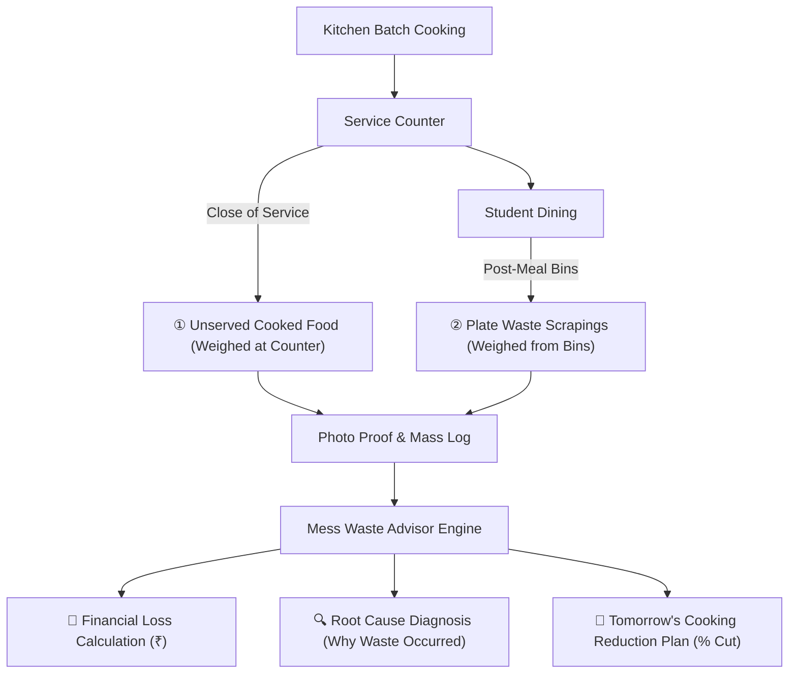

# 🍽️ Mess Waste Advisor
> **Latent 48: Bring the Physical World to AI — Granica × IIT Guwahati Hackathon**  
> *Team Liabilities | Tanish Agarwal • Rishi Agarwal • Madhav Goel (IIT Guwahati, 2026)*

[](file:///c:/Users/HP/Desktop/Granica%20SAIL/Waste_management.html)
[](file:///c:/Users/HP/Desktop/Granica%20SAIL/waste_data.parquet)
[](file:///c:/Users/HP/Desktop/Granica%20SAIL/Granica%20Dataset%20(3).xlsx)

---

## 📌 1. Problem Definition & User Framing

### The Physical Problem
Hostel messes cook hundreds of kilograms of food thrice daily for thousands of resident students. Quantities are routinely set by habit and fixed catering routines rather than empirical consumption records. Waste leaves no structured trace: unserved kitchen leftovers and plate scrapings are discarded together into municipal bins without being weighed. As a result:
- The mess cannot distinguish whether waste is caused by **over-preparation (cooking too much)** or **recipe/portion dissatisfaction (students rejecting a dish)**.
- High-waste recipes and oversized portions repeat week after week with zero feedback loops.

### The Named Users & Decision-Makers
1. **Primary Operational User — The Hostel Mess Manager**: Decides daily cooking batch quantities (kg/liters) and ladling portion sizes for each meal.
2. **Institutional Decision-Makers — The Hostel Mess Committee & HAB (Hostel Affairs Board)**: Approves monthly catering menus, monitors contractor waste compliance, and penalizes recurring food waste.

### The Core Question
> *"For each meal, what is wasted, how much, why, and what should the mess change: the menu, the ladling portion, or the quantity cooked?"*

---

## 🧭 2. The Physical Workflow & Measurement Points



### The Two Measurement Streams:
1. **① Unserved Cooked Food (Kitchen Leftovers)**: Food prepared but never taken or served to students. Weighed directly in kitchen vessels at the close of service. *Primary lever: Batch Cooking Volume.*
2. **② Plate Waste (Scrapings)**: Food served onto student plates but discarded into post-meal waste dustbins. Weighed directly from the bins. *Primary lever: Portion Sizing & Recipe Acceptance.*

---

## 📊 3. Dataset Architecture & Data Honesty Audit

The dataset records physical post-meal audits conducted across IIT Guwahati hostel mess halls between **25 September 2026, 21:10** and **26 September 2026, 21:41** (~24.5-hour collection window).

### Schema & Data Dictionary

| Column Name | Data Type | Nulls | Description |
| :--- | :--- | :---: | :--- |
| `Date` | `Date (YYYY-MM-DD)` | 0 / 55 | Date the meal observation occurred |
| `Time` | `Time (HH:MM:SS)` | 0 / 55 | Intake/upload timestamp |
| `Hostel` | `Categorical` | 0 / 55 | Hostel mess hall name (Barak, Brahma, Dihing, Disang, Kameng, Kapili, Lohit, Siang, Umiam) |
| `Meal_type` | `Categorical` | 0 / 55 | One of `Breakfast`, `Lunch`, `Dinner` |
| `Unserved Food Wastage` | `Numeric (kg)` | 8 / 55 | Mass of unserved food left in kitchen pots at counter close |
| `Plate Food wastage - total`| `Numeric (kg)` | 22 / 55 | Mass of food scraped from eaten plates into dustbins |
| `Photo Proof` | `URL` | 0 / 55 | Google Drive URL providing photographic evidence of the waste bin / scale |

### Row Count & Observation Deduplication
- **Raw Rows**: 55 entries (resulting from multi-angle photo captures of the same audit event).
- **Unique Observation Events**: **24 events** (deduplicated by `Date`, `Time`, `Hostel`, `Meal_type`).
- **Visual Provenance**: 100% of recorded events are linked to timestamped photo proofs.

### Data Honesty & Provenance Breakdown

| Category | Extent | Method & Integrity Treatment |
| :--- | :---: | :--- |
| **Observed (Direct)** | ~92% Unserved, ~50% Plate | Direct digital scale readings with exact decimal precision (e.g., `38.255 kg`, `63.46 kg`, `9.94 kg`). |
| **Inferred (Proxy)** | ~1 confirmed event | Derived via calibrated volumetric proxy ($2.5\text{ ft vessel} \approx 46\text{ kg}$; rice density $\approx 1.4\text{ g/mL}$) for Kameng Lunch when floor scales were inaccessible. |
| **Synthetic Data** | **0% (None)** | Strictly authentic physical observations. Zero synthetic or simulated entries. |
| **Missing Values** | 8 Unserved, 22 Plate | Retained as genuine `NaN` values without artificial interpolation. |

---

## 📈 4. Key Empirical Findings & Strategic Insights

From the 24 deduplicated multi-hostel observation events:

| Metric | Unserved Cooked Food | Served Plate Waste | Total Food Waste |
| :--- | :---: | :---: | :---: |
| **Events Recorded** | 22 of 24 events | 12 of 24 events | 24 events |
| **Mean Waste per Event** | **13.3 kg** | **44.8 kg** | **58.1 kg** |
| **Observed Range** | 2.0 kg – 35.0 kg | 22.4 kg – 74.8 kg | 24.4 kg – 89.8 kg |
| **Primary Operational Lever** | Batch Cooking Volume | Portion Sizing & Recipe Quality | Menu & Batch Planning |

### Takeaways for Mess Management:
1. **Plate waste is 3.3× larger than unserved food**: Students throwing away food from their plates ($44.8\text{ kg avg}$) represents the largest economic and ecological loss. Portion control (standardizing scoops to 100g) takes priority over kitchen preparation cuts alone.
2. **Inter-Hostel Efficiency Benchmark**: Lean hostels (e.g., Siang, Umiam) maintain waste below $35\text{ kg/meal}$, whereas others exceed $80\text{ kg/meal}$. Lean messes serve as internal operational benchmarks.
3. **Evidence-Based Accountability**: Timestamped photos eliminate subjective estimation arguments between catering managers and student committees.

---

## 💻 5. System Architecture & Solution Deliverables

```
Granica SAIL/
├── README.md                           # Comprehensive documentation & problem statement audit
├── Mess-Waste-Advisor.pdf              # 4-slide hackathon presentation deck
├── granica ps.pdf                      # Granica Hackathon problem brief
├── Granica Dataset (3).xlsx            # Source Excel dataset (Data + Summary sheets)
├── waste_data.parquet                  # Open Parquet format with embedded metadata schema
├── waste_data_clean.csv                # Cleaned 24-event dataset
├── waste_data_raw.csv                  # Raw 55-row CSV export
├── ai_waste_vision_parser.py           # Multimodal AI vision analysis script
├── menu/                               # Official IIT Guwahati Hostel Menu PDFs (12 hostels)
│   ├── Barak_August_Menu.pdf
│   ├── Brahmaputra _september_menu.pdf
│   ├── Dhansiri_August_Menu.pdf
│   ├── Dihing_August_Menu_.pdf
│   ├── Disang_August_Menu.pdf
│   ├── Gaurang_August_Menu_.pdf
│   ├── Kameng_August_Menu.pdf
│   ├── Lohit_August_Menu.pdf
│   ├── Manas_August_Menu.pdf
│   ├── Siang_August_Menu.pdf
│   ├── Subansiri_August_Menu.pdf
│   └── Umiam_August_Menu.pdf
└── Waste_management.html        # Interactive Single-Page Application & Analytics Dashboard
```

---

## 🛠️ 6. Dashboard Features & Mess Manager Portal

The dashboard ([`Waste_management.html`](file:///c:/Users/HP/Desktop/Granica%20SAIL/Waste_management.html)) provides an end-to-end interactive experience:

### A. 2-Step Mess Manager Intake & AI Diagnostics
- **Full 7-Day Menu Inventory (`menu/` PDFs)**: Extracted and structured authentic dishes from all 12 IIT Guwahati official menu PDFs.
- **Complete 7-Day Dish Checklist**: Selecting any Hostel Mess and Meal Slot (e.g., *Barak Dinner*) automatically displays the **entire 7-day inventory of dinner dishes** organized into:
  - `🍚 Main Staples & Breads` (e.g., Dum Biryani, Veg Fried Rice, Butter Naan, Latcha Paratha, Chole Bhature, Plain Roti)
  - `🍲 Dals & Curries` (e.g., Chicken Butter Masala, Paneer Butter Masala, Dal Maharani, Dal Tadka, Kadai Paneer)
  - `🥗 Vegetables & Sabjis` (e.g., Aloo Carrot Beans, Aloo Bhindi Bhaja, Aloo Parwal Bhaji)
  - `🥛 Accompaniments, Sides & Sweets` (e.g., Hot Gulab Jamun, Vanilla Ice Cream, Boondi Raita, Watermelon Juice)
- **Weekday Pre-Select Filters**: Quick-pills (`[All 7-Day Dishes]`, `[Mon]`, `[Tue]`, `[Wed]`, `[Thu]`, `[Fri]`, `[Sat]`, `[Sun]`) that highlight and pre-tick that weekday's scheduled items.
- **Zero-Clutter Photo Upload**: Upload the leftovers photo proof (or select instant demo presets).
- **Instant AI Waste & Financial Breakdown**:
  - ⚖️ **Waste Mass (kg)**: Kitchen leftovers vs plate scrapings and dustbin fill level (%).
  - 💸 **Money Lost (₹)**: Raw ingredients cost lost, cooking fuel (LPG) & labor loss, single-meal loss (e.g., ₹3,450), and projected monthly burn (e.g., ₹1,03,500).
  - 🔍 **Root-Cause Diagnosis**: Analyzes whether waste was caused by turnout shortfalls or student plate portion rejection.
  - 🍳 **Tomorrow's Cooking Reduction Plan**: Prescribes specific batch reduction percentages (e.g., "-25% Steamed Rice, -20% Dal") and standardized 100g portion scoops with projected savings.
  - 💾 **1-Click Live Dataset Log**: Appends the audit into the active dataset, updating charts and rankings in real time.

### B. Analytics Suite & Visual Gallery
- **Hostel Efficiency Rankings**: Ranks hostels based on per-meal waste averages (`Good`, `Moderate`, `Poor`).
- **Interactive Multi-Level Filtering**: Slice-and-dice by Hostel, Meal Type, and Date.
- **Comparative Multi-Hostel Analysis Mode**: Evaluates aggregate leftover vs. plate waste ratios across active filter slices.
- **Chart Suite (Chart.js)**: Hostel comparisons, meal-type averages, temporal trends, and waste proportion donut charts.
- **Embedded Photo Evidence Gallery**: Direct thumbnail viewer for all linked Google Drive photo proofs.

---

## 🔍 7. Honest Limitations & Gaps (Evaluation Disclosure)

In adherence to hackathon evaluation guidelines:
1. **Temporal Horizon**: The dataset spans a ~24.5-hour window across 2 calendar days. Multi-week longitudinal tracking is needed to model cyclical patterns.
2. **Meal Distribution Skew**: Breakfast (32 raw rows) and Lunch (19 raw rows) have strong coverage; Dinner (4 raw rows across 3 hostels) was under-sampled due to nighttime kitchen access restrictions.
3. **Headcount Normalization**: Official turnstile/footfall counts were not recorded by entry gates, limiting cross-hostel comparisons to absolute kilograms rather than per-capita ($g/\text{student}$).
4. **Volumetric Proxies**: A subset of high-volume container estimations relied on density conversions rather than floor scales.

---

## 🚀 8. Quickstart Guide

### 1. View the Interactive Dashboard
Double-click [`Waste_management.html`](file:///c:/Users/HP/Desktop/Granica%20SAIL/Waste_management.html) to open in any web browser, or serve locally:
```bash
python -m http.server 8000
```
Then navigate to: `http://localhost:8000/Waste_management.html`

### 2. Inspect Dataset with Python / Pandas
```python
import pandas as pd

# Load Parquet format
df = pd.read_parquet("waste_data.parquet")
print(df.info())
print(df.head())
```

### 3. Test AI Multimodal Vision Pipeline
```bash
python ai_waste_vision_parser.py
```

---

## 👥 9. Authors
- **Team Liabilities** — IIT Guwahati (2026)
  - Tanish Agarwal
  - Rishi Agarwal
  - Madhav Goel
